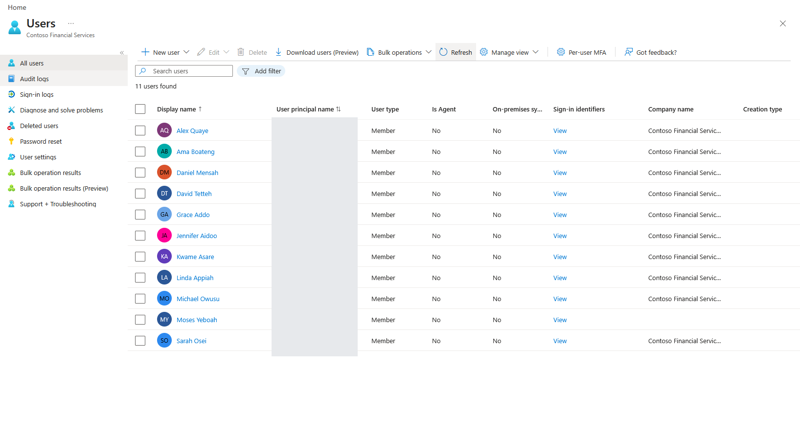
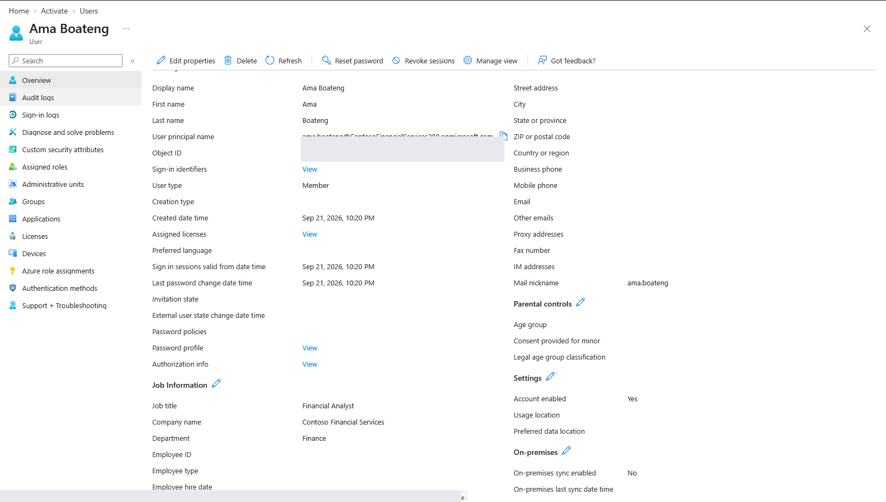
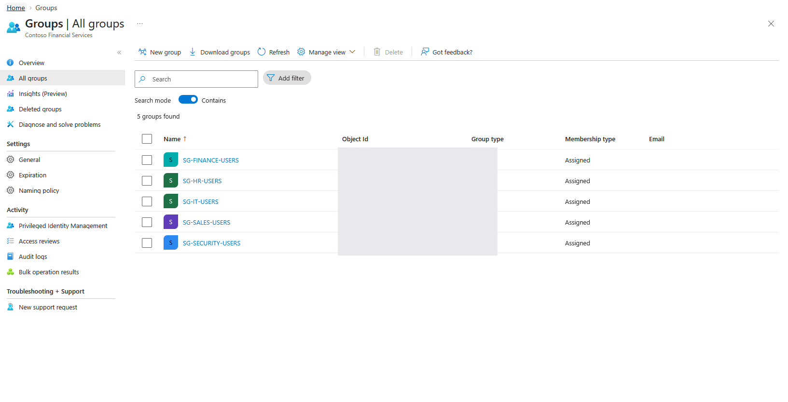
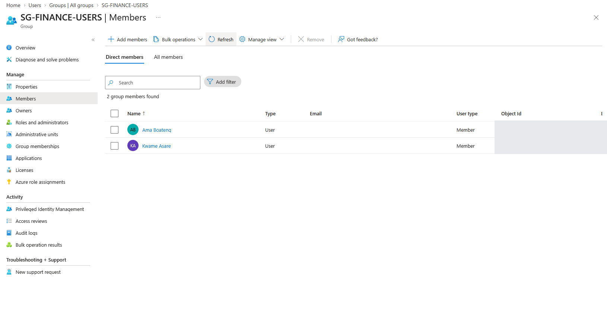
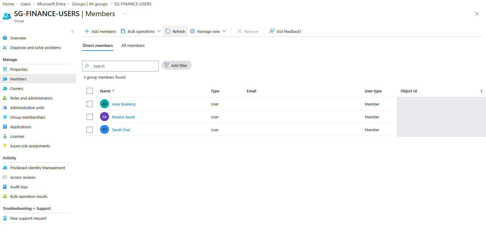
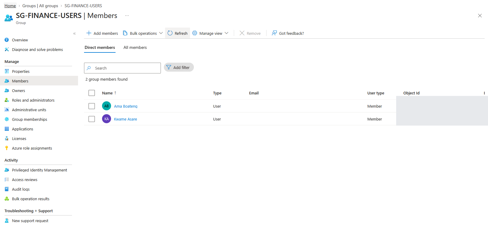

# Lab 01: Identity Foundation and Least-Privilege Group Membership

## Business context
Contoso Financial Services, a fictional financial institution, uses Microsoft Entra ID to manage workforce identities across IT, Finance, HR, Sales, and Security. Departmental security groups provide an organizational basis for later application and resource assignments.

## Security objective
Establish identifiable workforce accounts and consistent departmental group membership, then detect and remediate a deliberately introduced cross-department access error.

## Environment
- Identity platform: Microsoft Entra ID
- Workforce scope: Ten fictional departmental employee accounts, plus an existing administrator identity shown in the user inventory
- Five assigned security groups: `SG-IT-USERS`, `SG-FINANCE-USERS`, `SG-HR-USERS`, `SG-SALES-USERS`, and `SG-SECURITY-USERS`

## Implementation
1. Provisioned fictional departmental users with organizational attributes such as Department, Company, and Job Title.
2. Created the five assigned security groups to reflect department-based access boundaries.
3. Verified Finance baseline membership: **Ama Boateng** and **Kwame Asare**.
4. Simulated inappropriate membership by adding **Sarah Osei** (HR) to `SG-FINANCE-USERS`.
5. Identified Sarah's membership as inconsistent with her department and removed it.
6. Verified Finance group membership returned to **Ama Boateng** and **Kwame Asare**.

## Finding: unnecessary Finance group membership
**Expected:** Only approved Finance users should belong to `SG-FINANCE-USERS`.

**Observed:** HR employee Sarah Osei temporarily appeared alongside Ama and Kwame.

**Risk:** Resources that trust the Finance group for authorization could unintentionally grant access to an employee without a Finance business need.

**Remediation:** Removed Sarah from the Finance group.

**Verification:** Compared the three-member before-remediation view with the restored two-member membership list.

**Scope of claim:** This exercise verifies **Entra group membership remediation**. No actual finance resource permission or data access test was performed in this module.

## Evidence sequence

### 1. Provisioned workforce identities
The user inventory shows the fictional tenant accounts used for departmental identity administration.

### 2. Verified identity attributes
Ama Boateng's user properties show her Finance department, Financial Analyst job title, and Contoso company association.

### 3. Established departmental security groups
Five assigned security groups provide separate departmental membership boundaries.

### 4. Established the Finance baseline
Only Ama Boateng and Kwame Asare appear as direct Finance group members.

### 5. Simulated excessive membership
Sarah Osei, an HR employee, was deliberately added to the Finance security group to represent an unauthorized departmental entitlement.

### 6. Remediated and verified
Sarah was removed. The Finance group returned to its expected two direct members.

**Evidence interpretation:** Screenshots show Entra directory configuration and group membership changes. They do not demonstrate actual Finance application or dataset access.

## Outcome
Demonstrated a repeatable identity foundation and a practical least-privilege control cycle: **baseline → access anomaly → investigation → remediation → verification**.
