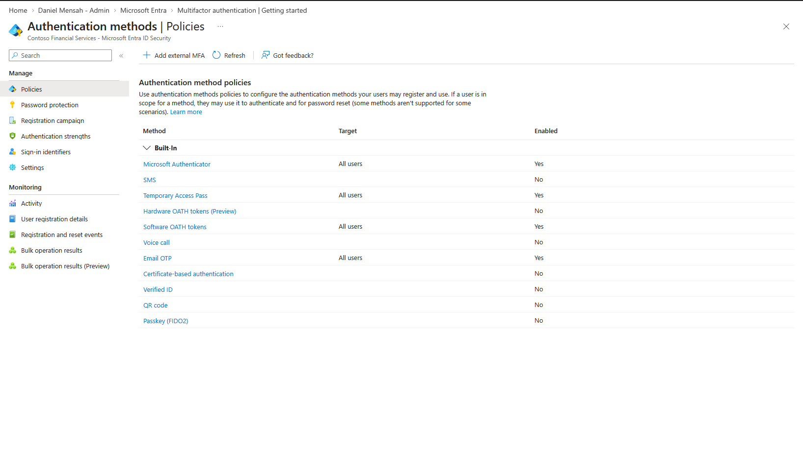
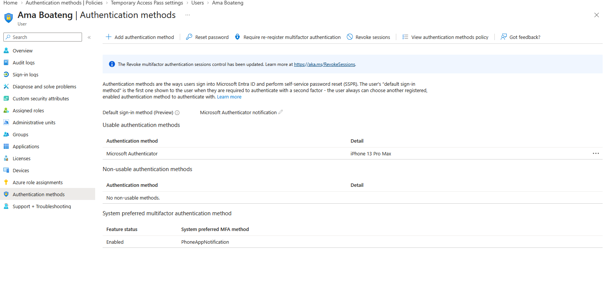
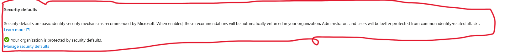
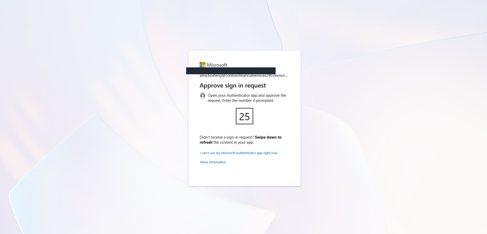
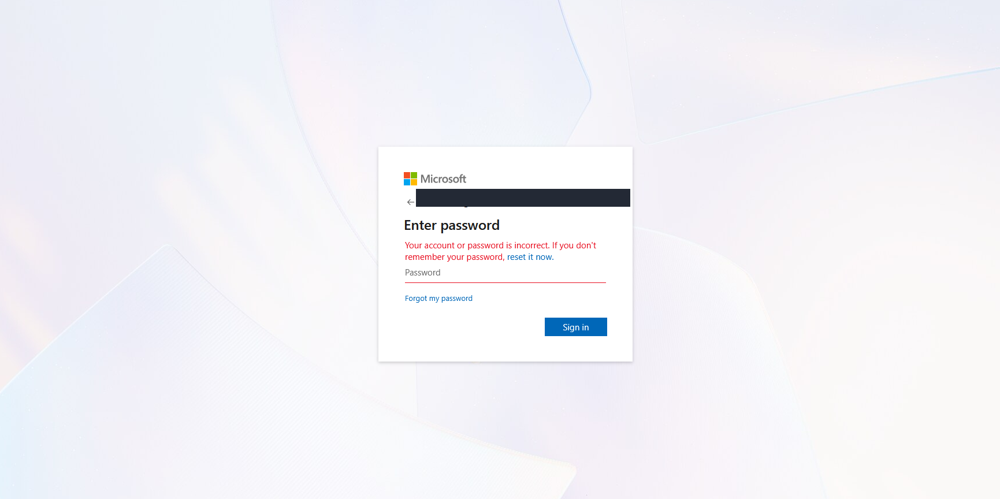
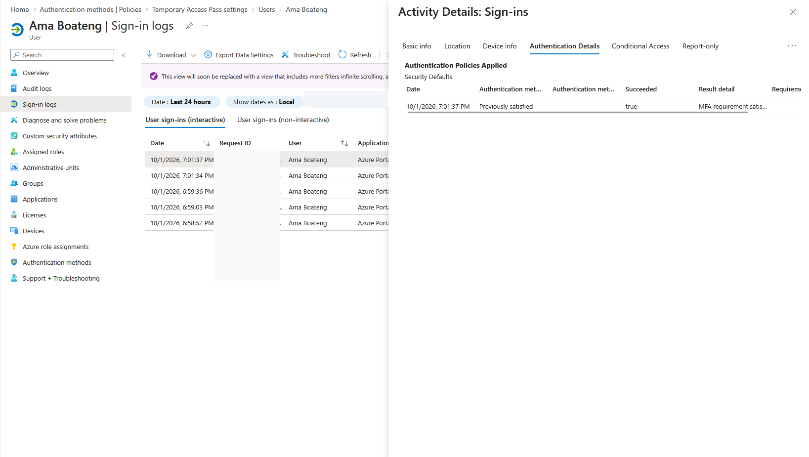
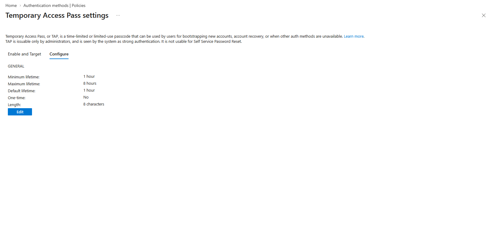
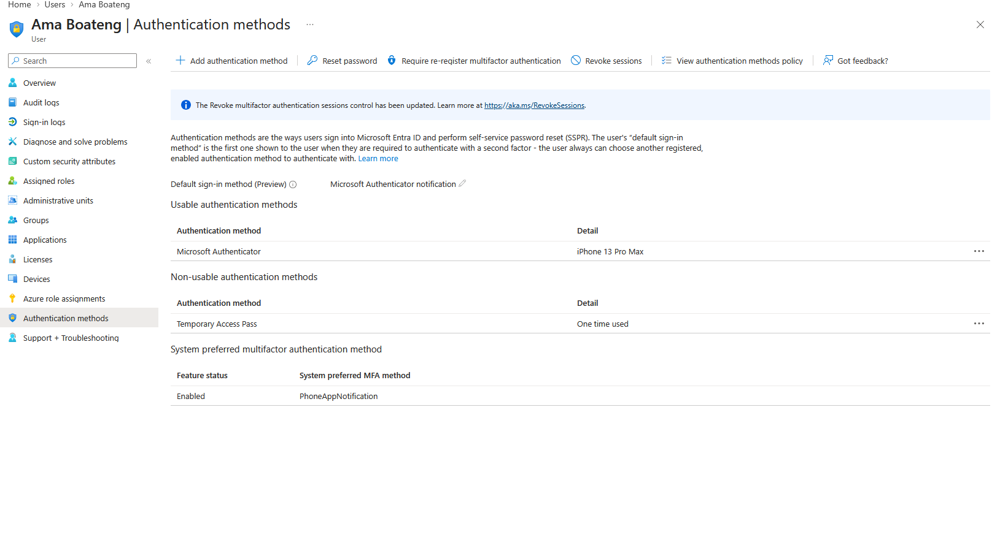
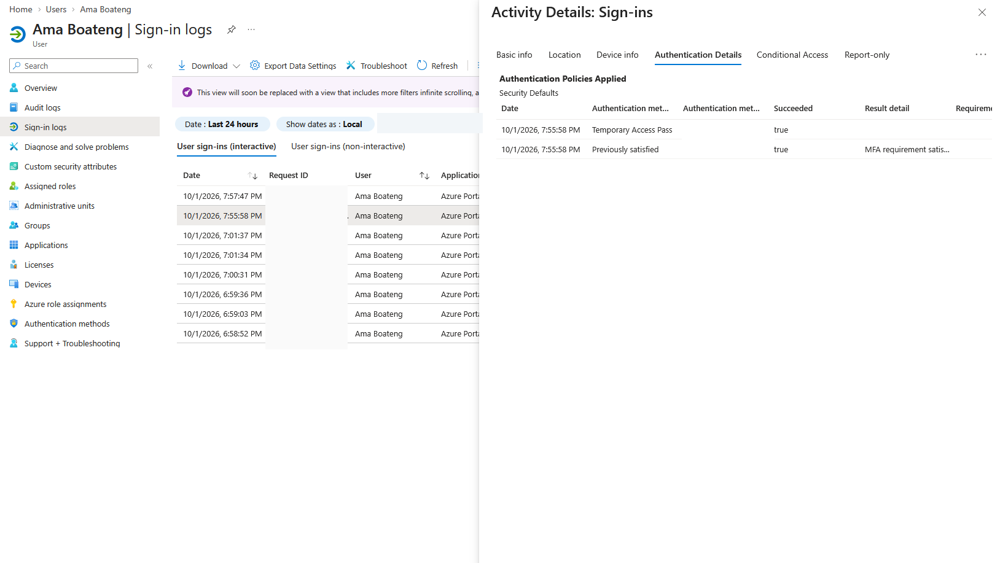

# Lab 03 — Authentication, MFA and Temporary Access Pass Recovery

## Business scenario
Contoso Financial Services must verify workforce identities using appropriately configured authentication methods, detect failed sign-ins, and provide a controlled recovery path when a user's usual authentication method is unavailable.

## Security objectives
- Distinguish **tenant authentication-method policy** from an individual user's **registered methods** and from **actual sign-in activity**.
- Verify a Microsoft Authenticator MFA challenge and interpret sign-in logs.
- Investigate a password failure without confusing it with an MFA failure.
- Examine Temporary Access Pass (TAP) policy and validate a TAP-based sign-in.
- Preserve authentication evidence without exposing credentials or tenant-specific identifiers.

## Test identity and environment
- Test identity: **Ama Boateng**, fictional Finance employee.
- Platform: **Microsoft Entra ID**.
- Authentication: Microsoft Authenticator; Security Defaults; Temporary Access Pass.

## Implementation and verification

### 1. Inspected allowed authentication methods
The tenant's authentication methods policy permitted Microsoft Authenticator, Temporary Access Pass, software OATH tokens, and email OTP for their configured uses. SMS, voice call and FIDO2 passkeys were disabled in the captured baseline.

**Interpretation:** A method being *enabled by policy* does not establish that every user has registered or used it.

### 2. Verified the user's registered method
Ama's user authentication methods page showed Microsoft Authenticator registered, with notification as the default sign-in method. System-preferred MFA selected app notification.

**Interpretation:** Registration shows an available authentication method; it is not proof that MFA occurred on a particular sign-in.

### 3. Checked baseline protection
Tenant properties indicated that **Security Defaults** were enabled. This established the baseline security configuration recorded at that point in the lab; it does not substitute for an evaluation of individual Conditional Access policies.

### 4. Tested an Authenticator sign-in challenge
A fresh sign-in presented a **number-matching** approval request for Ama in Microsoft Authenticator. This demonstrates that an MFA challenge was issued.

### 5. Investigated a failed sign-in
A password entry failed. This was a **password authentication problem**, not evidence of Authenticator denying the request. The password was corrected/reset before a later successful sign-in.

### 6. Validated recorded MFA satisfaction
A subsequent sign-in authentication details view showed **Security Defaults**, **Succeeded: true**, and **Previously satisfied** with the MFA requirement satisfied.

**Interpretation:** The log shows Entra accepted existing authentication evidence for this event. It does not independently prove that a new Authenticator approval occurred in that exact log entry; the live number-matching capture is separate evidence.

### 7. Examined TAP policy
The captured TAP policy had:
- Minimum lifetime: **1 hour**
- Maximum lifetime: **8 hours**
- Default lifetime: **1 hour**
- One-time policy setting: **No**
- Length: **8 characters**

TAP is intended for authentication bootstrapping and recovery; it is not a temporary Entra administrative role.

### 8. Validated TAP use and sign-in
Ama's authentication methods page subsequently displayed a **non-usable Temporary Access Pass** described as **One time used**. A sign-in authentication details record showed **Temporary Access Pass**, **Succeeded: true**, and an additional **Previously satisfied** successful entry.

**Supported conclusion:** A one-time TAP was used successfully for authentication.

**Evidence limitation:** The supplied captures do not demonstrate new-device enrollment or prove that the previous Microsoft Authenticator registration was replaced. Therefore, this lab does **not** claim an end-to-end lost-phone re-enrollment workflow.

## Evidence

Place the sanitized images in this module's `evidence/` folder. The case study links will display once the images are uploaded.

### 1. Tenant authentication method baseline

### 2. Registered Microsoft Authenticator

### 3. Security Defaults baseline

### 4. Live MFA number matching challenge

### 5. Failed password sign-in

### 6. Successful sign-in with MFA previously satisfied

### 7. TAP policy settings

### 8. Used one-time TAP

### 9. Successful TAP sign-in audit record

## Results and security observations

| Control / test | Observation | Scope of proof |
| --- | --- | --- |
| Authenticator method policy | Enabled | Tenant permits use |
| Authenticator registration | Present for Ama | User has a usable registered method |
| MFA challenge | Number matching presented | Interactive challenge occurred |
| Initial password authentication | Failed | Password stage failed |
| Later authentication log | MFA requirement previously satisfied | Successful event; not necessarily fresh MFA |
| Temporary Access Pass | One-time pass used | TAP consumption observed |
| TAP sign-in | Succeeded | TAP was accepted for authentication |
| Device re-enrollment | Not demonstrated | Not claimed |

## Security outcome
Demonstrated the distinction between **policy**, **registration**, **challenge**, **sign-in evidence**, and **recovery authentication**. Investigated a failed password sign-in, validated an MFA requirement in the logs, and observed successful Temporary Access Pass authentication without publishing credentials.

## Limitations
This module does not demonstrate completed phishing-resistant authentication, successful enrollment on a replacement phone, or an application-specific Conditional Access policy. Those would require separate implementation and validation.
