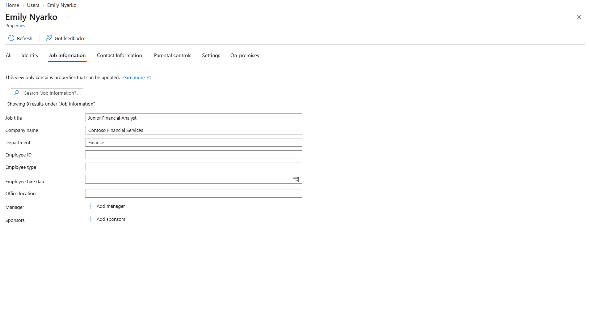
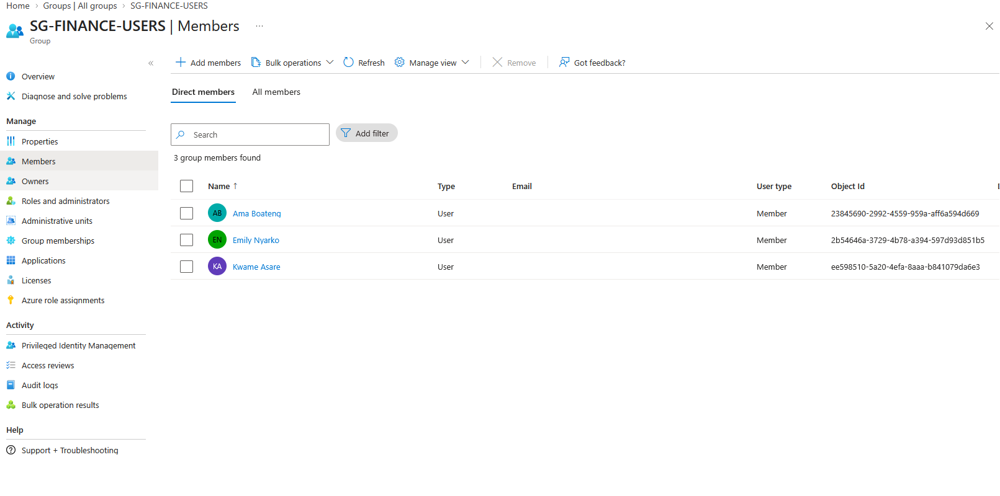
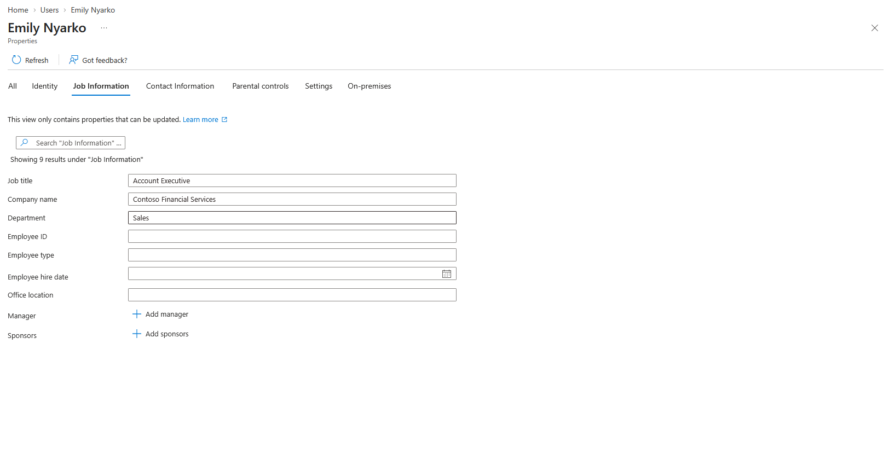
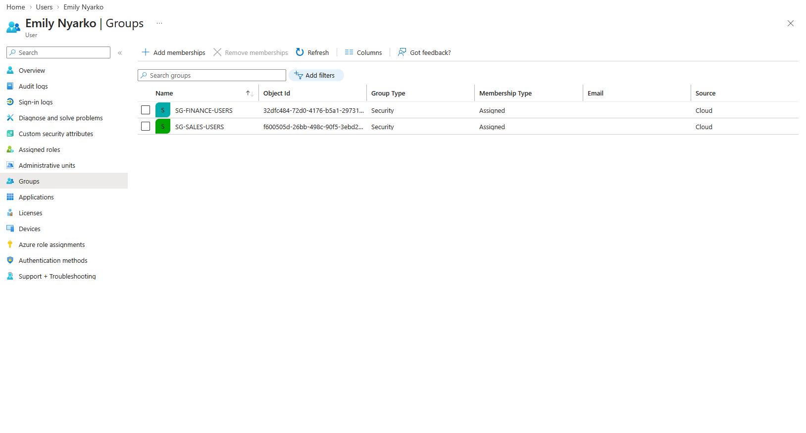
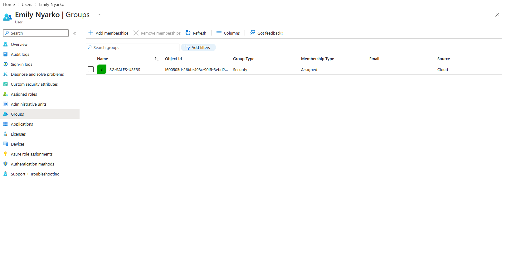
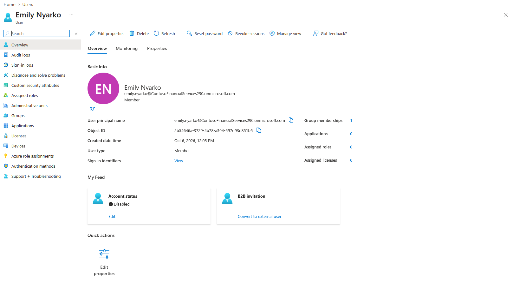
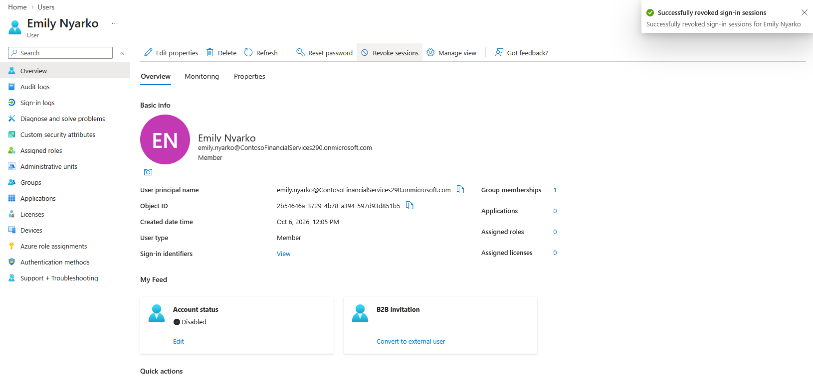
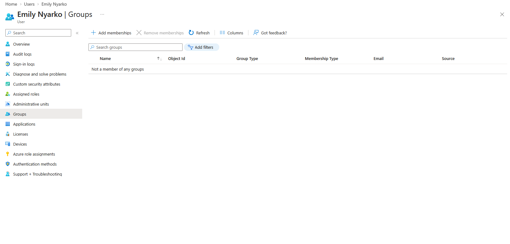
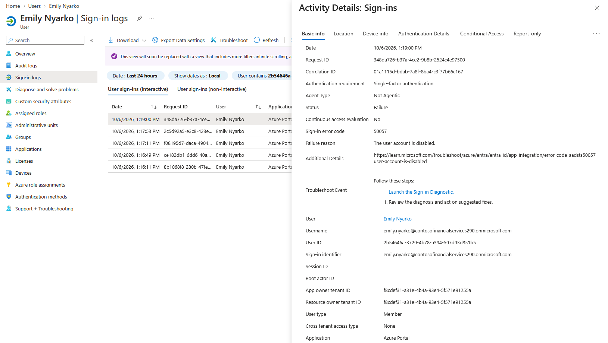

# Lab 05: Joiner, Mover, Leaver (JML) Identity Lifecycle Management

## Business scenario

Contoso Financial Services needs a controlled process for provisioning new employees, updating entitlements during internal transfers, and disabling identities when employees leave. This lab follows fictional employee **Emily Nyarko** across the identity lifecycle in Microsoft Entra ID.

## Objectives

- Create a new Finance user and assign role-appropriate group membership.
- Simulate a transfer to Sales and identify accumulated access from the previous department.
- Remove obsolete Finance membership and verify Sales-only membership.
- Disable a departing employee account, revoke sign-in sessions, and remove remaining group membership.
- Validate denied sign-in using the Microsoft Entra sign-in logs.

## 1. Joiner: initial provisioning

Emily joined Contoso as a **Junior Financial Analyst** in **Finance**. Her job attributes reflected this role, and she was added to `SG-FINANCE-USERS`.

**Observed:** The directory listed Emily as a member of the Finance security group. This demonstrates group-based assignment, not access to a particular finance application.

## 2. Mover: detect and remediate accumulated access

Emily transferred to **Sales** as an **Account Executive**. Her directory job attributes were changed to the new department and title.

A review of her group memberships then identified both `SG-FINANCE-USERS` and `SG-SALES-USERS`. Retaining the previous department's group after transferring demonstrates an **access-accumulation risk**.

The obsolete Finance membership was removed. The resulting membership list contained only `SG-SALES-USERS`.

**Observed:** Unnecessary group membership was corrected. The screenshots do not independently prove that specific downstream application permissions were removed.

## 3. Leaver: disable and clean up identity

When Emily left Contoso, her account was disabled.

Existing sign-in sessions were revoked; the portal displayed a successful confirmation.

Her remaining group membership was removed, leaving the account with no listed groups.

A subsequent sign-in test produced a failed sign-in event with **Microsoft Entra error 50057: The user account is disabled**.

## Verification matrix

| Lifecycle stage | Intended result | Evidence observed |
| --- | --- | --- |
| Joiner | Finance identity and membership | Job title / department and Finance group membership |
| Mover | Update to Sales and remove previous access | Finance + Sales membership overlap identified; Finance membership removed |
| Leaver | Disable identity | Account status: Disabled |
| Leaver | Revoke sessions | Success confirmation displayed |
| Leaver | Remove group memberships | No group memberships listed |
| Negative sign-in test | Disabled user cannot sign in | Failure, code 50057, user account disabled |

## Technical limitations and design judgment

- Group membership is a directory entitlement. This lab does **not** claim proven authorization to finance or sales application data.
- The transfer and cleanup steps were manual. No HR-driven automation, SCIM, dynamic group rule, or entitlement workflow was implemented.
- Session revocation does not necessarily invalidate all previously issued application access tokens instantly.
- The negative sign-in test validates the disabled-account control for the tested Entra sign-in, not the status of all possible downstream applications and sessions.
- The account was disabled rather than deleted so the identity and its audit records remain available for verification.

## Security outcome

The lab demonstrates a complete **Joiner → Mover → Leaver** sequence, including detection of access accumulation, correction of outdated group membership, controlled offboarding, and negative authentication testing.
