# Lab 06: Privileged Identity Management (PIM)

## Overview

This lab examines the risk of standing administrative permissions in a fictional **Contoso Financial Services** Microsoft Entra ID environment. A dedicated administrative identity, **Daniel Mensah - Admin**, initially held a permanent active **Helpdesk Administrator** assignment. The lab replaces that standing privilege with a **PIM eligible** assignment and tests time-bound activation, administrative interface behavior, deactivation, and audit records.

**Scope:** Microsoft Entra ID Privileged Identity Management for the Helpdesk Administrator role. The exercise demonstrates a lab configuration rather than a production rollout.

## Business problem and security risk

IT support personnel need privileged capabilities for occasional helpdesk tasks, but a permanent active role increases the period in which a compromised privileged account could be abused. The design objective was to retain eligibility for legitimate support activity while requiring an explicit activation step before the role becomes active.

## Initial condition

Daniel's dedicated administrator identity had a **direct, permanent active Helpdesk Administrator** assignment. Both his user role assignments and the PIM directory assignments view showed standing privilege.

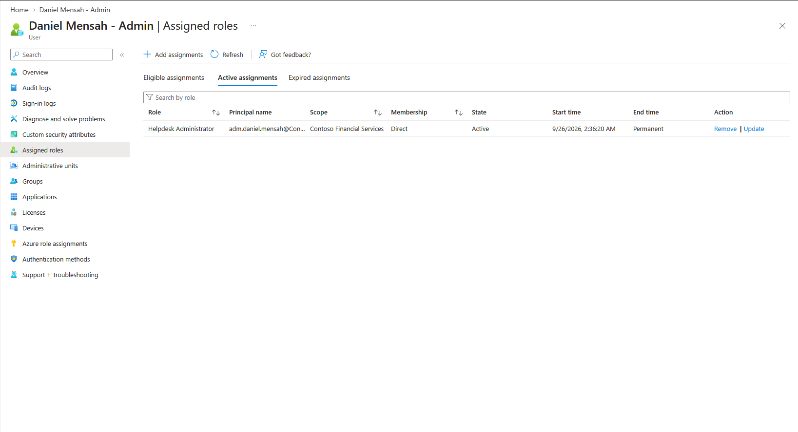

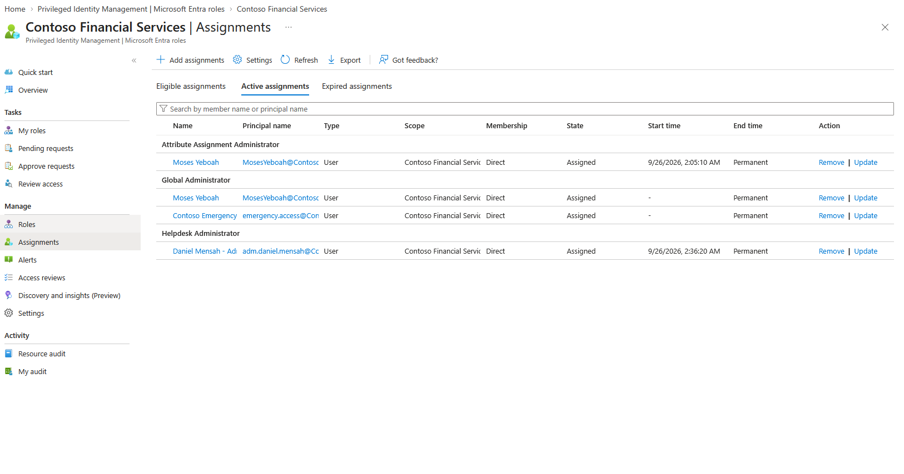

## PIM role configuration

The Helpdesk Administrator activation settings were configured as follows:

| Control | Observed configuration |
|---|---|
| Maximum activation duration | 1 hour |
| On activation, require | Azure MFA |
| Justification on activation | Required |
| Ticket information | Not required |
| Approval to activate | Not required |
| Permanent eligible assignments | Allowed |
| Permanent active assignments | Not allowed |
| Active assignment expiry | 15 days |

These settings make eligibility persistent while limiting each activated session to at most one hour. **Permanent eligibility is not equivalent to permanent active permission.** The screenshots do not establish that approval, ticket-based authorization, or additional privileged-access conditions were deployed.

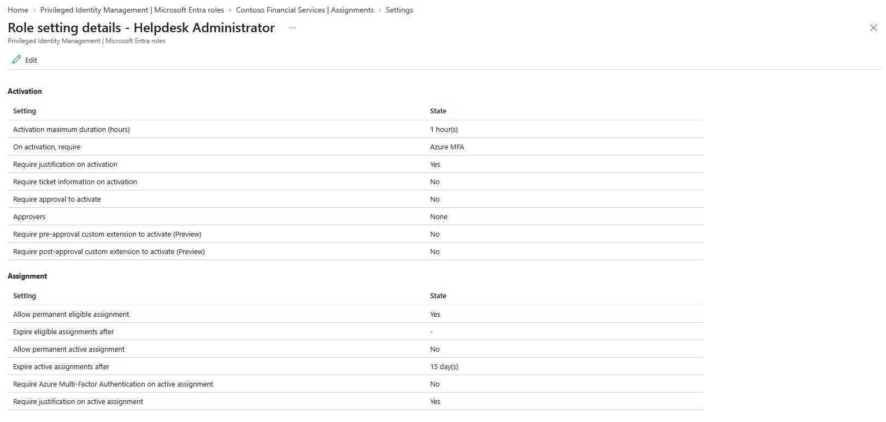

## Implementation and validation

### 1. Replace standing access with eligibility

The existing standing assignment was removed. Daniel's user role page then showed no active assignment, while the directory's PIM assignments page showed an **eligible** Helpdesk Administrator assignment.

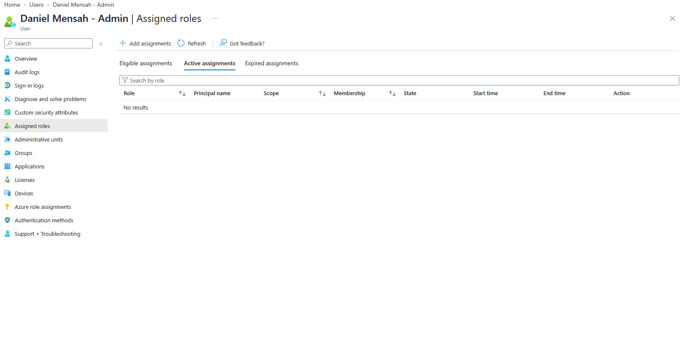

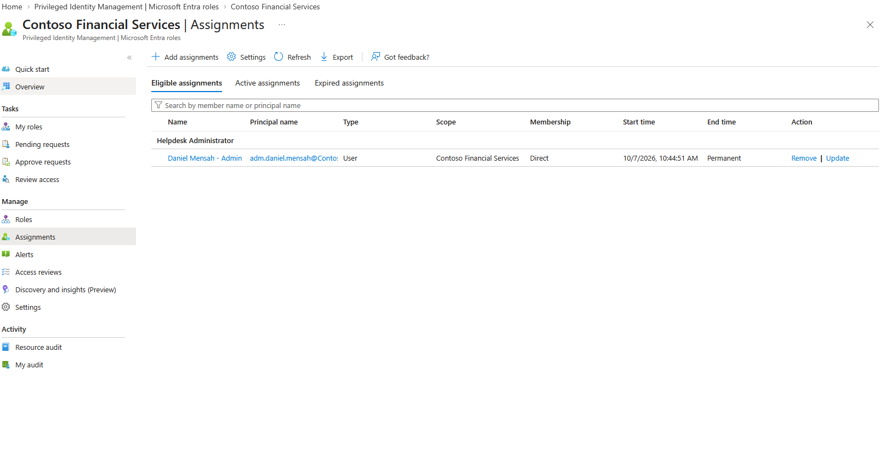

### 2. Verify the eligible state

In the PIM **My roles** view, Daniel could see the Helpdesk Administrator role under **Eligible assignments**, with an **Activate** action.

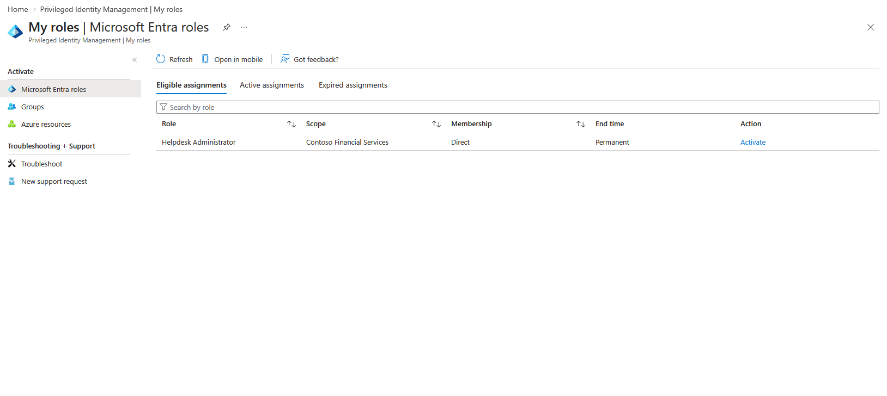

### 3. Activate time-limited privilege

After activation, the role appeared under **Active assignments** in an **Activated** state with a specific end time. This supports that a time-bounded JIT activation was in effect for this session.

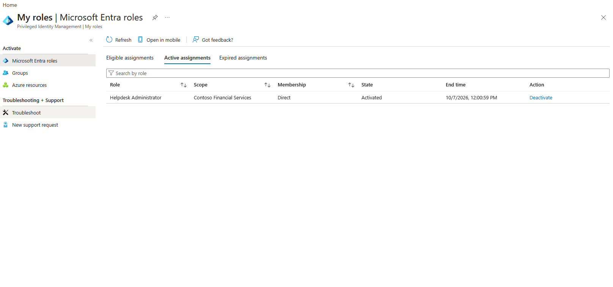

### 4. Inspect privileged operations

During the activated period, the test captured a password-reset dialog for a lab account. The screenshot shows that the reset workflow was available but **does not show completed password-reset confirmation**. It should therefore be understood as interface/authorization-path evidence, not a successful password-reset test.

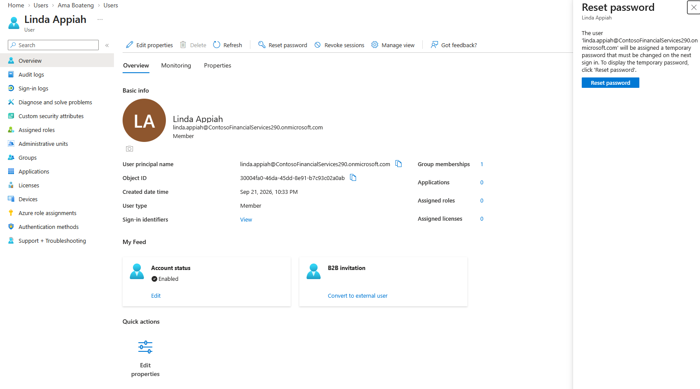

### 5. Deactivate the role and retest

After deactivation, the PIM **My roles** screen again showed the role as eligible and no active role in the paired comparison. A subsequent password-reset attempt displayed an administrative-privilege error. This is consistent with the intended least-privilege outcome, although the error message allows other causes and does not alone establish causation.

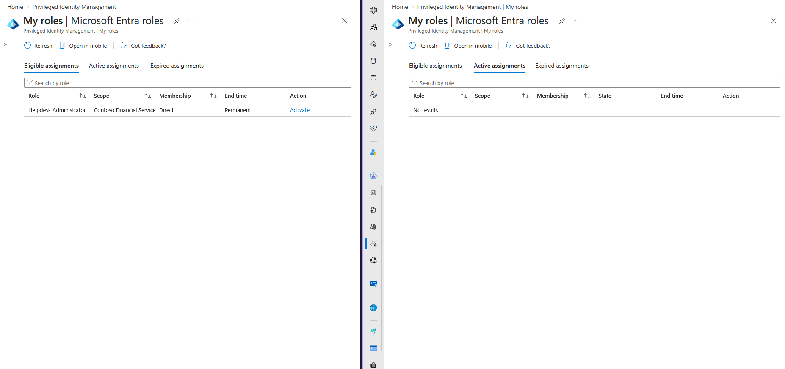

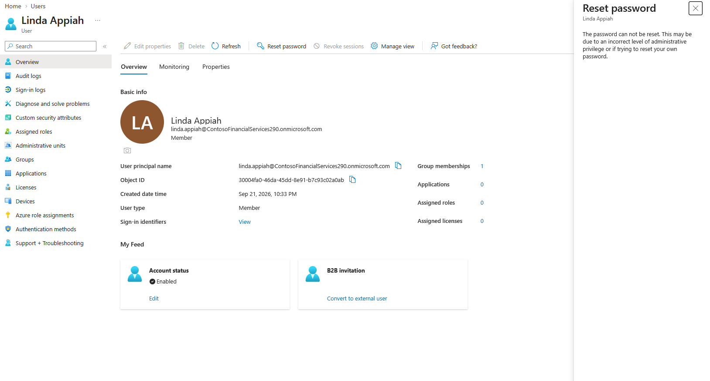

### 6. Verify the audit trail

PIM resource audit details recorded successful **role activation** and **deactivation requested/completed** events for Daniel's Helpdesk Administrator role. The audit screenshot is the strongest evidence that the privilege lifecycle was recorded.

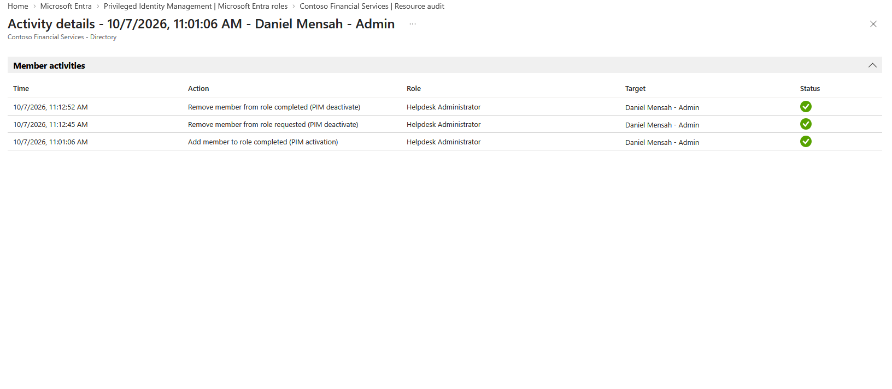

## Outcome

The lab demonstrated a move from standing Helpdesk Administrator access to an eligible role with **MFA, justification, and a one-hour maximum activation**. Screenshots show an activated interval, return to eligibility after deactivation, and corresponding successful PIM audit events.

### What this lab does not establish

- An approval-based PIM activation workflow (approval was not required).
- A successful password reset during activation (only the reset dialog is shown).
- Definitive causality for the post-deactivation reset error without a matched success test and detailed authorization logs.
- Automated detection, alerting, or broader tenant-wide privileged access governance.

## Security principles demonstrated

- **Least privilege:** Reduce standing administrative permissions.
- **Just-in-time access:** Activate privileged roles only for the period needed.
- **Separation of identity:** Perform administrative work with a dedicated administrator account.
- **Stronger authentication:** Require MFA for role activation.
- **Accountability:** Require justification and retain privileged-activity audit records.

## Evidence inventory

| # | Screenshot | Purpose |
|---|---|---|
| 01 | [Standing privilege before](evidence/01-standing-privilege-before.png) | Permanent active role baseline |
| 02 | [PIM standing assignment](evidence/02-pim-active-assignment-before.png) | Confirmation in directory assignments |
| 03 | [Role settings](evidence/03-role-activation-settings.png) | Activation requirements |
| 04 | [Standing role removed](evidence/04-standing-privilege-removed.png) | No active assignment on user page |
| 05 | [Eligibility configured](evidence/05-eligible-assignment.png) | Eligible PIM role |
| 06 | [Before activation](evidence/06-eligible-before-activation.png) | Activate action available |
| 07 | [Activated role](evidence/07-jit-role-activated.png) | Time-bound active role |
| 08 | [Privileged workflow](evidence/08-privileged-operation-dialog.png) | Password-reset interface available |
| 09 | [Deactivated role](evidence/09-role-deactivated.png) | Eligible/active comparison |
| 10 | [Post-deactivation test](evidence/10-post-deactivation-password-reset-error.png) | Privilege error observed |
| 11 | [Audit trail](evidence/11-pim-activation-deactivation-audit.png) | Activation and deactivation records |
