# Lab 07 - Identity Governance

## Overview

This lab demonstrates identity governance in Microsoft Entra ID by using **Access Reviews** to validate membership of the **SG-FINANCE-USERS** security group. The objective was to simulate a periodic certification process, delegate the review to a business reviewer, evaluate system recommendations, apply review decisions, and verify the resulting access changes through group membership and audit evidence.

## Objectives

- Create an access review for the **SG-FINANCE-USERS** group
- Assign a reviewer to evaluate group membership
- Review Microsoft Entra recommendations for each member
- Approve or deny continued access
- Apply review results to group membership
- Verify the outcome using group membership and audit logs

## Scenario

A quarterly-style access certification was created for the **SG-FINANCE-USERS** group. The reviewer evaluated three members:

- **Ama Boateng**
- **David Tetteh**
- **Kwame Asare**

Microsoft Entra provided recommendations during the review. The reviewer approved continued access for **Ama Boateng** and **Kwame Asare**, and denied continued access for **David Tetteh**. After the review results were applied, David Tetteh was removed from the group, while Ama Boateng and Kwame Asare remained members.

## Technologies Used

- Microsoft Entra ID
- Microsoft Entra ID Governance
- Access Reviews
- Group Management
- Audit Logs

## Implementation Steps

### 1. Created the access review

An access review named **AR-Finance-Group-Membership** was created for the **SG-FINANCE-USERS** group.

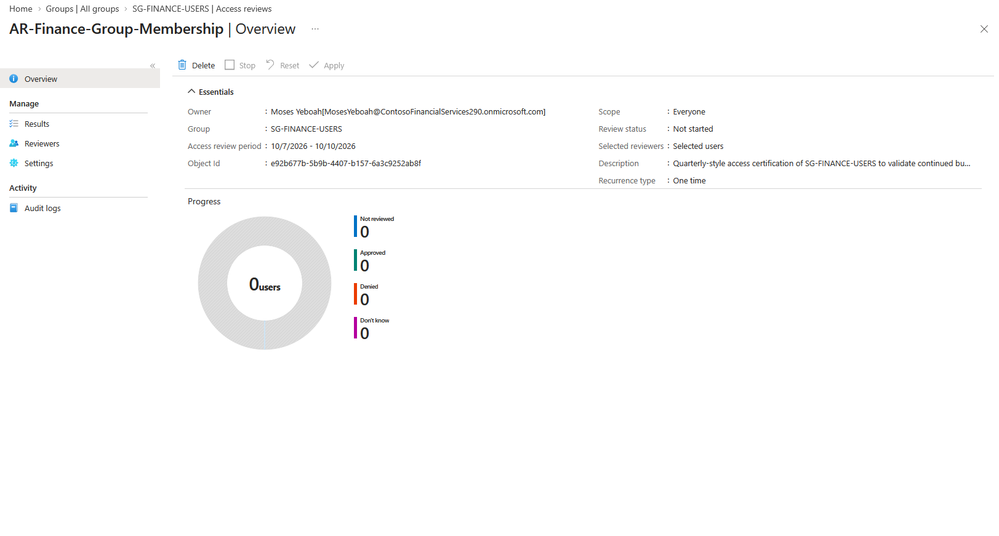

### 2. Verified group membership before the review

Before decisions were made, the SG-FINANCE-USERS group contained three members.

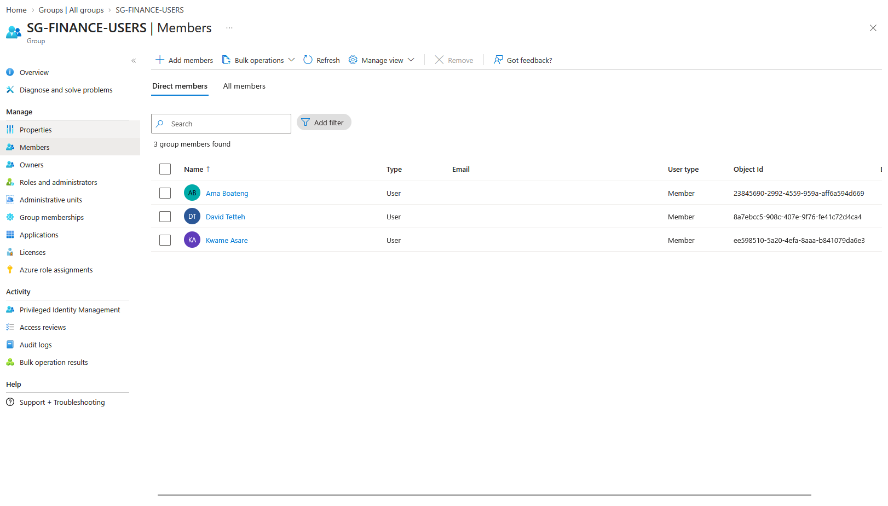

### 3. Confirmed the review became active

The review moved to an active state and showed the pending members to be evaluated.

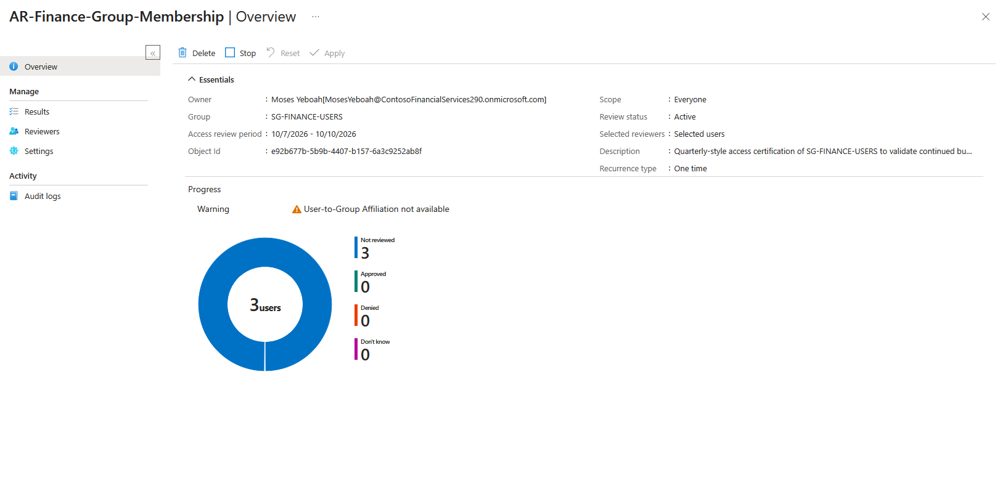

### 4. Verified reviewer visibility in My Access

The assigned reviewer could see the review under **My Access > Access reviews**.

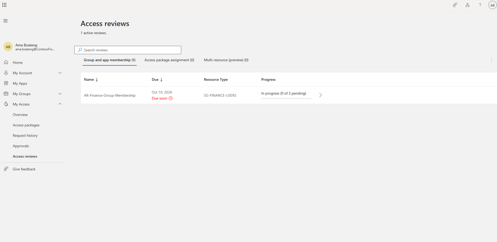

### 5. Reviewed recommendations

The reviewer opened the review and saw system recommendations for each member:

- Ama Boateng — **Approve**
- David Tetteh — **Deny**
- Kwame Asare — **Deny**

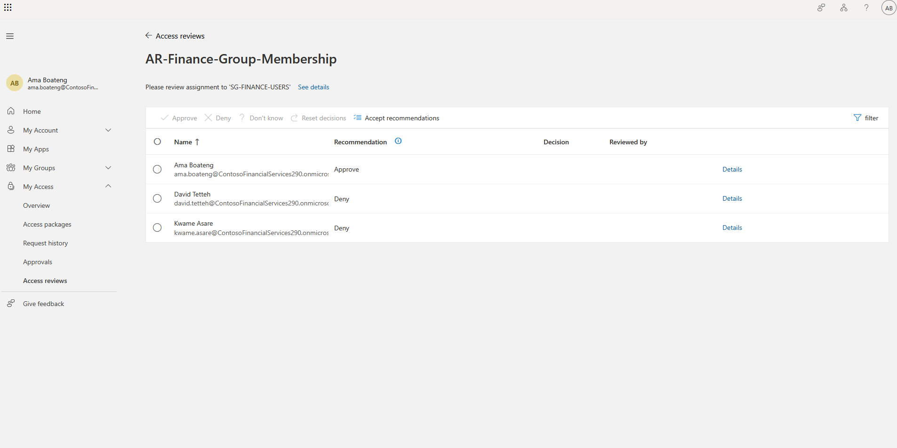

### 6. Submitted access review decisions

The reviewer submitted the following decisions:

- Ama Boateng — **Approved**
- David Tetteh — **Denied**
- Kwame Asare — **Approved**

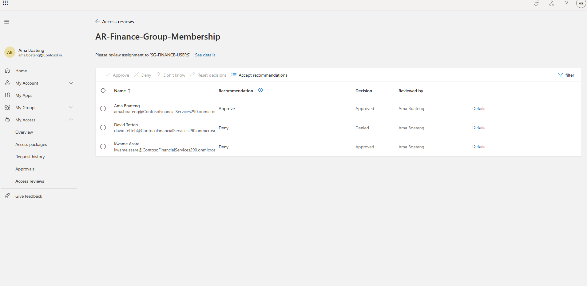

### 7. Verified the review results

The review results showed:

- **2 Approved**
- **1 Denied**

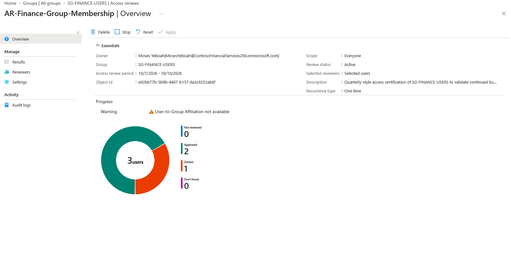

### 8. Confirmed the review completed

The access review status later showed as **Complete**.

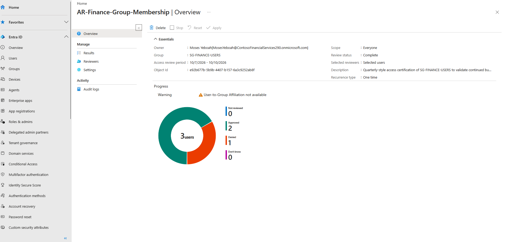

### 9. Verified final group membership

After the review results were applied, the SG-FINANCE-USERS group had only two remaining members:

- Ama Boateng
- Kwame Asare

David Tetteh was no longer a member.

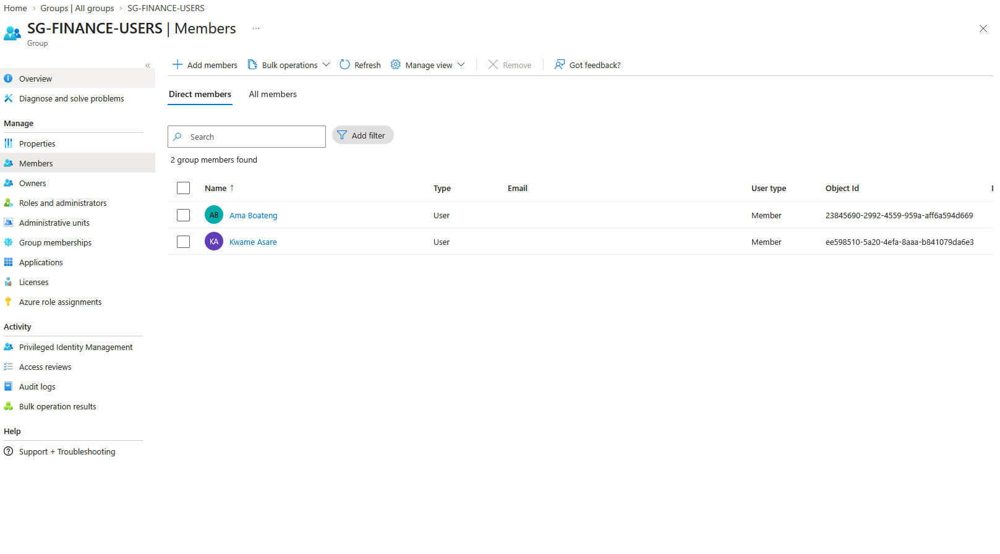

### 10. Validated audit activity

Audit logs showed the creation of the access review and the member removal event.

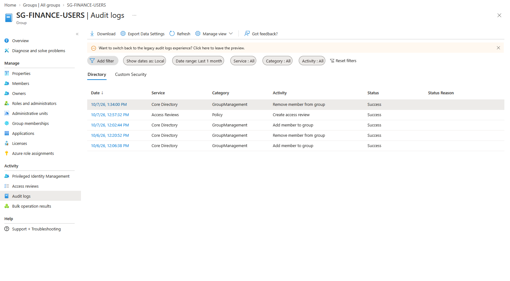

### 11. Confirmed audit log target details

Detailed audit information confirmed that **David Tetteh** was the removed user.

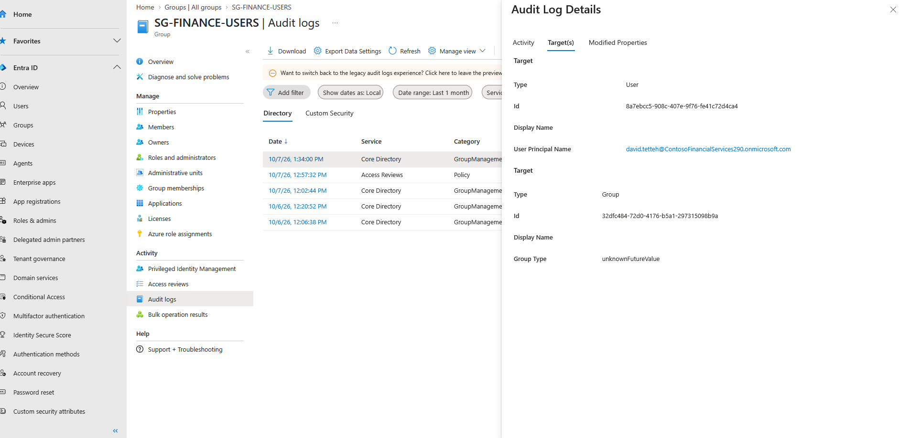

## Key Findings

- Access Reviews provide a practical control for periodic validation of group membership.
- Reviewers can use system recommendations while still applying business judgment.
- Identity governance decisions can directly affect group membership.
- Audit logs provide traceability for both review creation and access changes.

## Outcome

This lab successfully demonstrated how Microsoft Entra ID Governance can be used to certify access, remove unnecessary permissions, and maintain auditable control over group membership.
