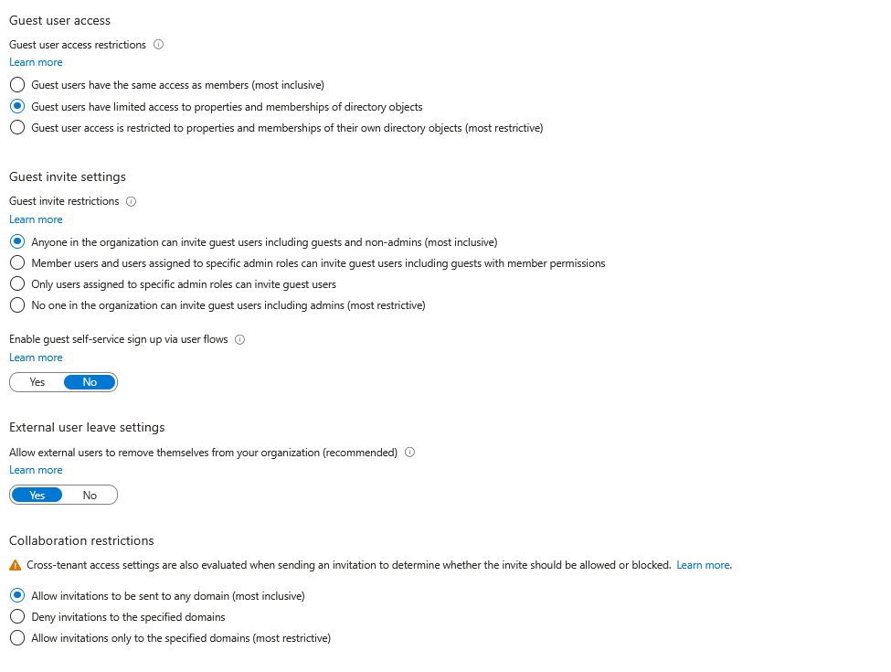
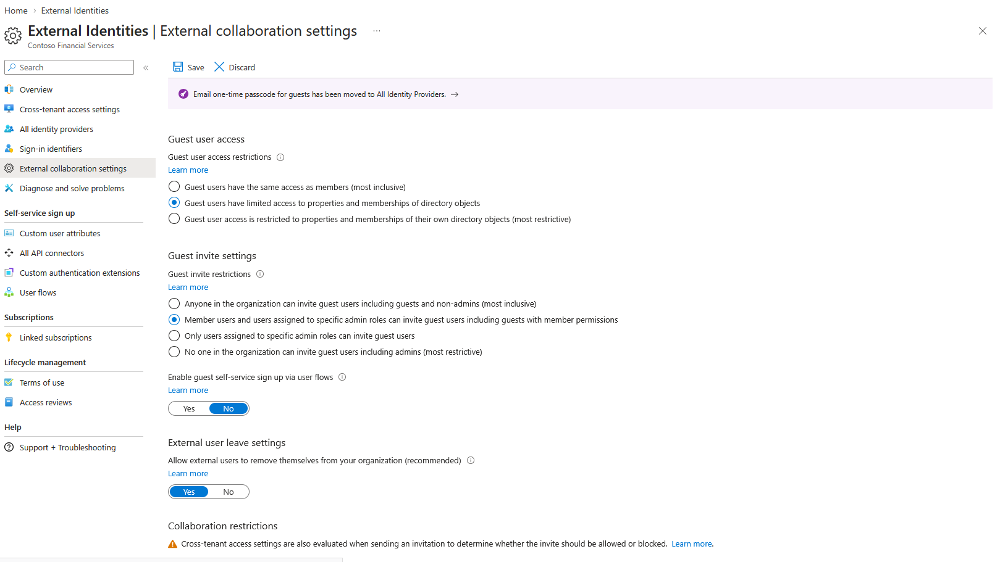
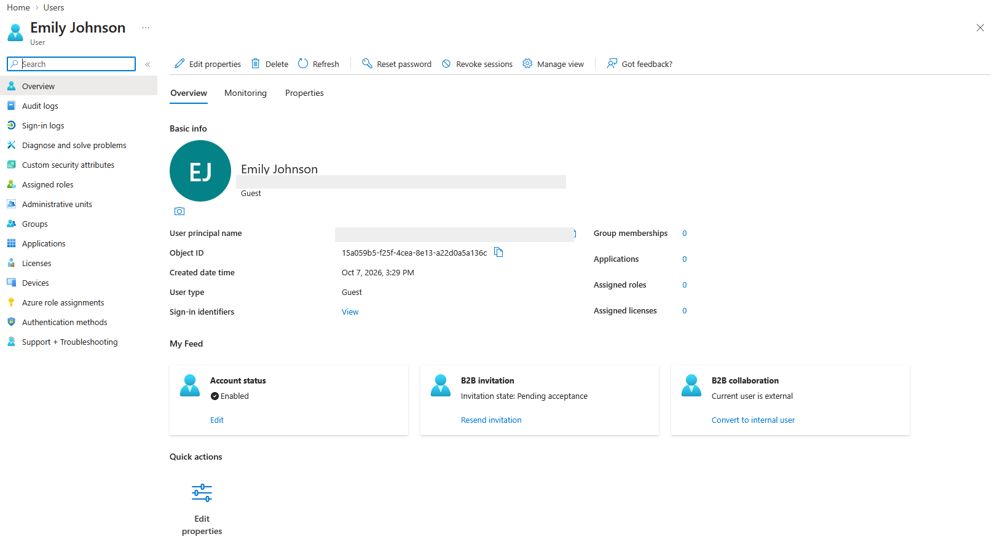
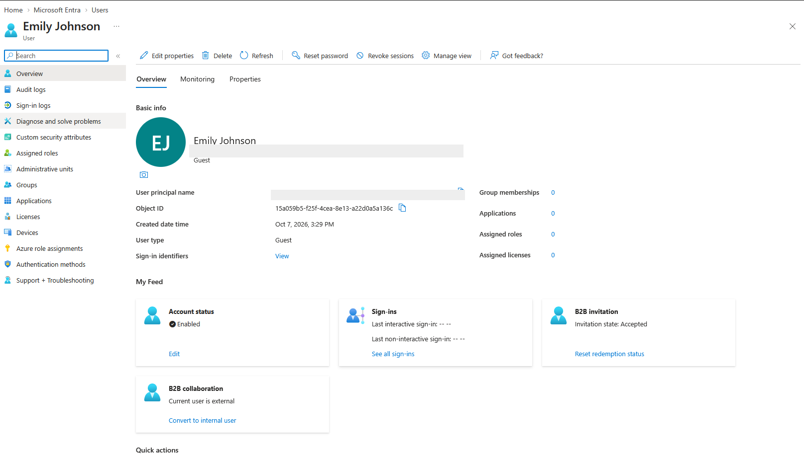
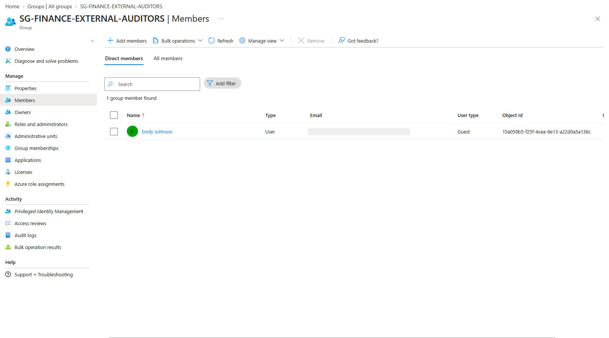

# Lab 08 - External Identities and B2B Guest Collaboration

## Overview

This lab demonstrates external identity management in Microsoft Entra ID using **B2B collaboration**. The exercise examined guest collaboration settings, created an external auditor identity, followed the invitation redemption lifecycle, and placed the guest in a dedicated security group rather than an internal Finance group.

## Objectives

- Review guest access and invitation restrictions in Microsoft Entra ID.
- Examine a more restrictive guest invitation setting.
- Invite an external collaborator as a B2B guest.
- Verify the guest invitation transitions from pending acceptance to accepted.
- Assign the guest to a dedicated external-auditor security group.
- Verify the resulting group membership.

## Scenario

Contoso Financial Services needed to collaborate with **Emily Johnson**, an external finance auditor. Because Emily was not an employee, the IAM design called for a **Guest** identity and a separate external-auditor group, **SG-FINANCE-EXTERNAL-AUDITORS**, rather than membership in **SG-FINANCE-USERS**.

The goal was to demonstrate a controlled external onboarding workflow while distinguishing guest invitation, invitation redemption, group assignment, and actual application access.

## Technologies Used

- Microsoft Entra ID
- External Identities / B2B Collaboration
- External Collaboration Settings
- Guest User Management
- Security Groups

## Implementation Steps

### 1. Reviewed external collaboration settings

Inspected the tenant's external collaboration configuration. The baseline showed limited guest directory access, while guest invitations were broadly permitted.

### 2. Examined more restrictive guest invitation permissions

Selected the option allowing **member users and users assigned to specific administrator roles** to invite guests. This was a least-privilege design consideration intended to reduce uncontrolled external invitations.

The screenshot records the selected option; it does **not** independently confirm the change was saved or became effective tenant-wide.

### 3. Created the external guest identity

Invited Emily Johnson to the tenant as a B2B guest. The guest account appeared as **User type: Guest**, with **Pending acceptance** as the invitation status and no group memberships at this stage.

### 4. Verified invitation redemption

After the invitation was accepted, the account's **B2B invitation state** changed to **Accepted**. This demonstrates successful guest invitation redemption, not yet access to a finance application.

### 5. Assigned the guest to a dedicated external-auditor group

Placed Emily Johnson in **SG-FINANCE-EXTERNAL-AUDITORS** and verified that she appeared as its direct member. Keeping external auditors separate from **SG-FINANCE-USERS** supports clearer access scoping and future review or removal of third-party access.

## Key Findings

- Microsoft Entra B2B collaboration supports onboarding external identities as guests without classifying them as internal employees.
- Guest invitation and redemption are separate from group assignment and application authorization.
- A dedicated external-auditor security group provides a clearer basis for least-privilege access management than adding guests to internal departmental groups.
- The collected evidence verifies guest creation, invitation acceptance, and group membership; it does not establish a completed application-level access test.

## Outcome

This lab demonstrated the B2B guest onboarding lifecycle for an external auditor and verified membership in a dedicated external-auditor security group. The resulting design separates third-party identities from internal Finance users and establishes a foundation for application assignment, access reviews, and eventual guest offboarding.
