# Lab 09 - Workload Identities

## Overview

This lab demonstrates how a non-human identity can authenticate to Microsoft Entra ID and call Microsoft Graph without using an employee password. In the fictional Contoso Financial Services environment, an automation application was registered, granted narrowly scoped read access, authenticated with a certificate, and tested against both permitted and forbidden API requests. The exercise also covered application ownership, certificate-expiration checks, and service principal sign-in monitoring.

## Objectives

- Create an application registration and identify its corresponding service principal.
- Configure and approve a Microsoft Graph application permission appropriate for a basic identity inventory.
- Authenticate with a locally protected certificate using Microsoft Graph PowerShell.
- Verify permitted read access and observe a denied request outside the application's scope.
- Assign an application owner and evaluate certificate expiration.
- Inspect service principal sign-in records and remove an unnecessary configured permission.

## Scenario

Contoso Financial Services needs an unattended process that can retrieve basic directory profiles without using a privileged employee account. The workload, **Contoso-IAM-Automation**, should authenticate as an application and must not have blanket administrative permissions. An IT systems administrator is responsible for the application's lifecycle and certificate renewal.

## Technologies Used

- Microsoft Entra ID App registrations and Enterprise applications
- Microsoft Graph and Microsoft Graph PowerShell
- Microsoft Graph application permissions and administrator consent
- X.509 certificate-based client credentials
- PowerShell certificate store and basic expiry checks
- Service principal sign-in logs

## Implementation Steps

### 1. Registered the workload application

Created **Contoso-IAM-Automation** as a single-tenant application. The overview shows its client ID, tenant ID, and application object ID. No client secret or redirect URI was configured at this point.

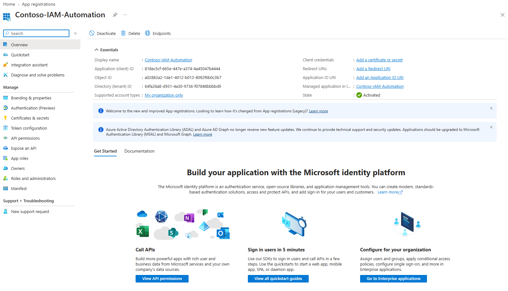

### 2. Located its service principal

Opened the managed enterprise application. The application registration and service principal share the **application (client) ID**, but have different directory **object IDs**.

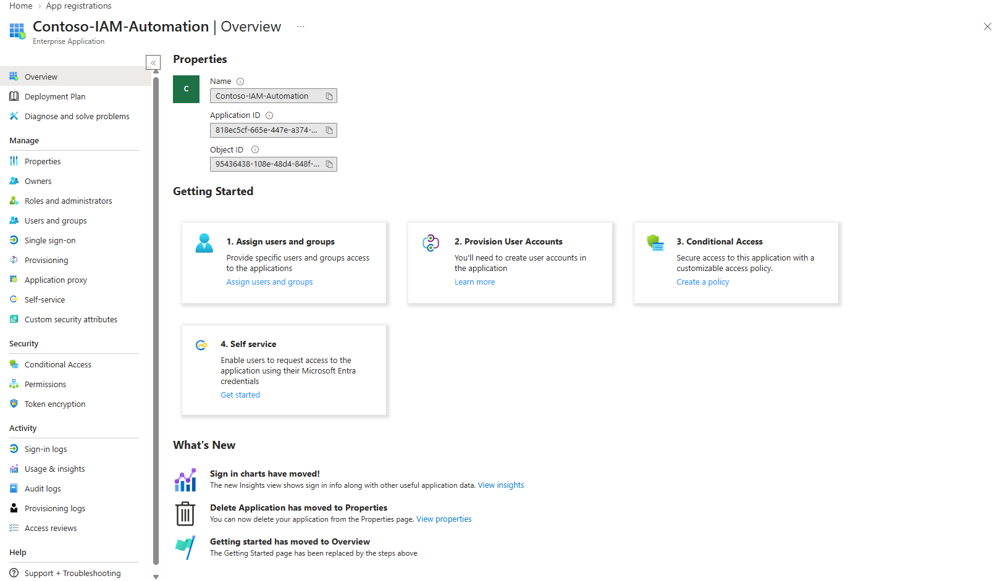

### 3. Examined the default permission baseline

The initial configured Microsoft Graph permission was **User.Read (Delegated)**. This permission is not used by an unattended, app-only script.

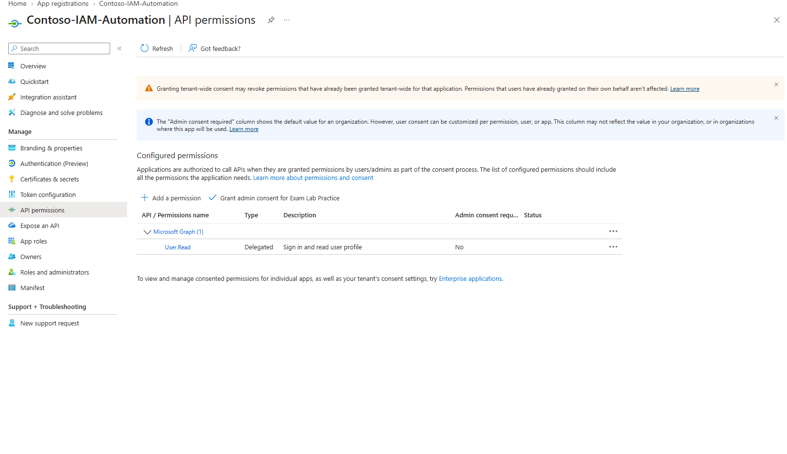

### 4. Added a narrowly scoped application permission

Configured **User.ReadBasic.All (Application)**, which allows app-only access to basic user profile properties. At this stage, the permission was listed but **not granted**.

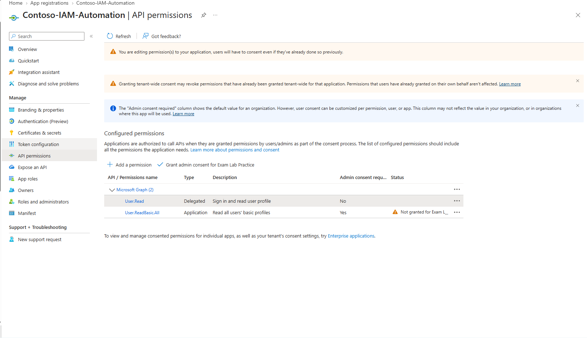

### 5. Granted administrator consent

An authorized administrator granted consent for the configured Microsoft Graph permissions. The portal subsequently displayed **Granted** for **User.ReadBasic.All** and the previously configured delegated permission.

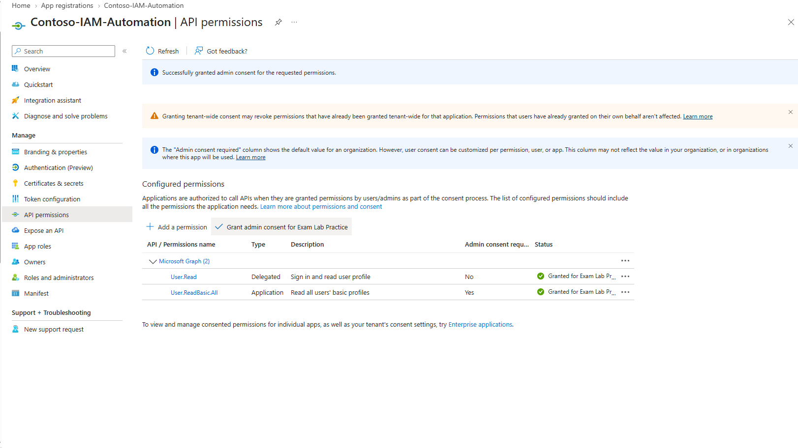

### 6. Created a local authentication certificate

Created a three-month, self-signed RSA certificate in the current Windows user's certificate store. The certificate had a private key and a non-exportable key policy. This is a lab credential, not a production certificate-management design.

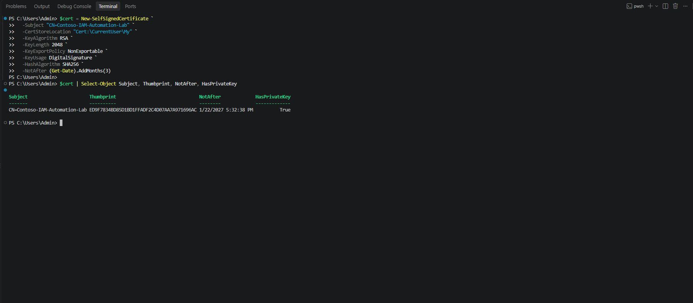

### 7. Registered the public certificate

Exported the public certificate and uploaded it to the app registration. The certificate list shows one certificate, **zero client secrets**, and an expiration date of **January 22, 2027**. The private key stayed in the local certificate store.

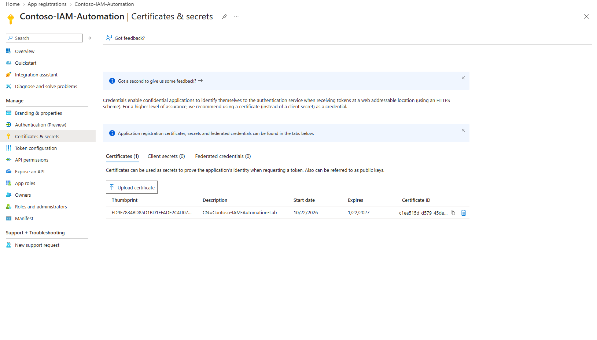

### 8. Verified permitted Microsoft Graph access

Connected to Microsoft Graph with app-only, certificate-based authentication and successfully executed a read-only `GET /v1.0/users` request restricted to basic properties (`id`, `displayName`, and `userPrincipalName`). The response displayed five directory users.

### 9. Tested authorization outside the granted scope

The same workload attempted a read-only `GET /v1.0/identity/conditionalAccess/policies` request and received **HTTP 403 Forbidden**. This is consistent with the workload lacking the application permission required to read Conditional Access policies. The screenshot does not show the complete underlying authorization diagnostics.

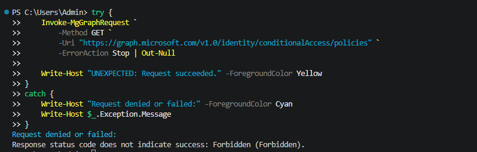

### 10. Identified an ownership gap

The app registration initially displayed **no assigned owners**. That leaves application accountability and credential maintenance unclear, although authorized directory administrators may still manage the app.

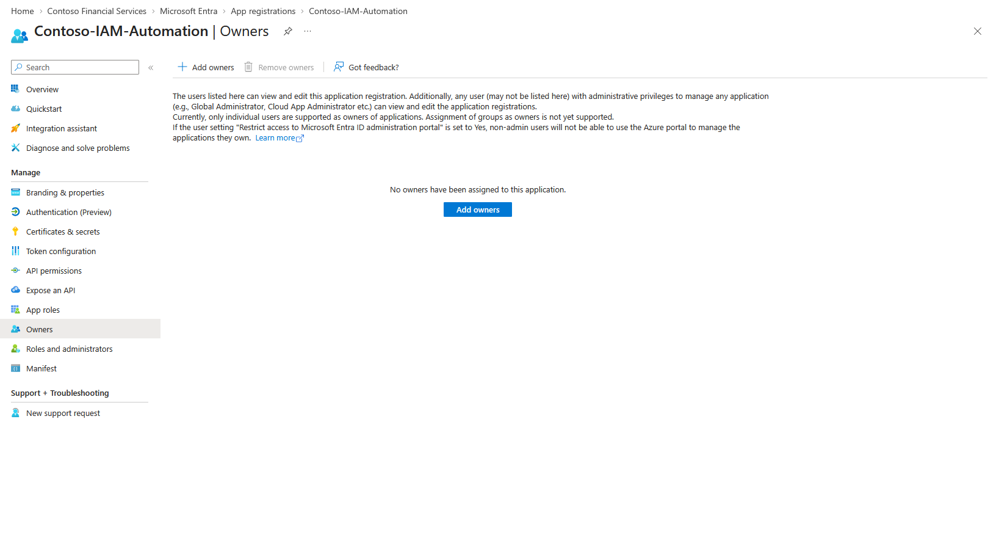

### 11. Assigned a technical owner

Assigned **Daniel Mensah**, a Systems Administrator in the fictional organization, as an explicit app registration owner. App ownership permits management of aspects of the registration; it does not itself grant Microsoft Graph directory-wide permissions.

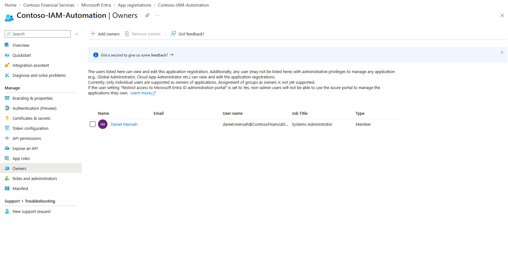

### 12. Checked local certificate expiration

Used PowerShell to inspect the certificate's local expiration date and classify its health using a 30-day warning threshold. The output reported approximately **91 days remaining** and **HEALTHY** at the time of the exercise.

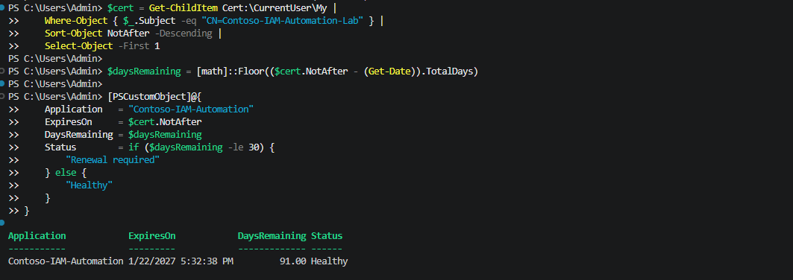

### 13. Simulated a renewal warning

Temporarily increased the threshold to **120 days**, producing a renewal warning for the same valid certificate. This exercised warning logic without changing or expiring the credential.

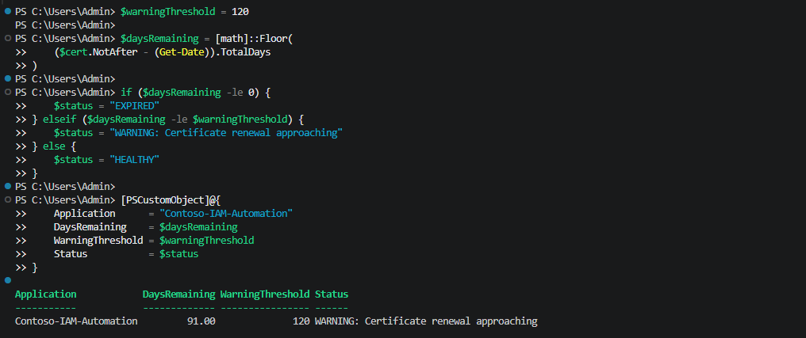

### 14. Ran a reusable local monitoring script

Saved a parameterized PowerShell script and ran it with 30-day and 120-day thresholds. The two executions returned **HEALTHY** and **WARNING**, respectively. A corresponding example is included in [Test-WorkloadCertificate.ps1](scripts/Test-WorkloadCertificate.ps1).

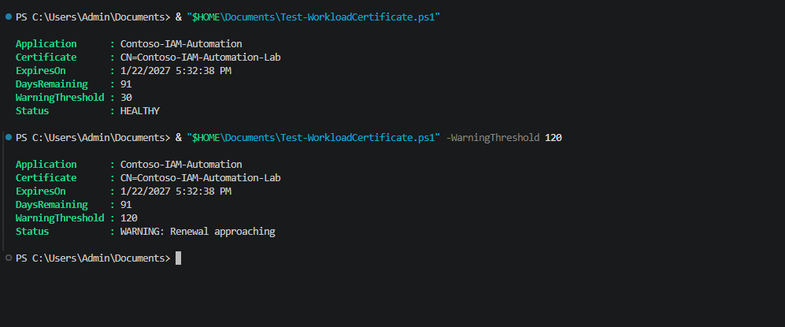

### 15. Investigated the service principal sign-in record

Microsoft Entra service principal sign-in logs showed a **Success** event for **Contoso-IAM-Automation** accessing **Microsoft Graph**. The credential thumbprint matched the certificate used in the lab, providing independent sign-in evidence for the app-only authentication. The record does not alone demonstrate which Graph API requests were authorized.

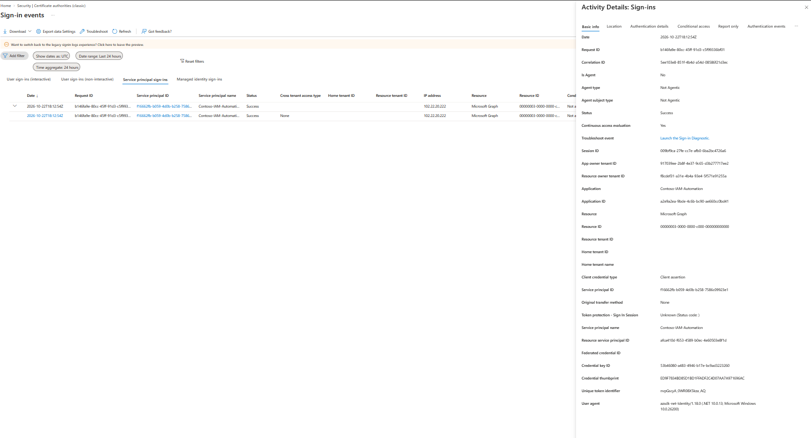

### 16. Removed an unnecessary configured delegated permission

Removed the unused **User.Read (Delegated)** permission from the app registration. The final configuration view lists only **User.ReadBasic.All (Application)** with granted status.

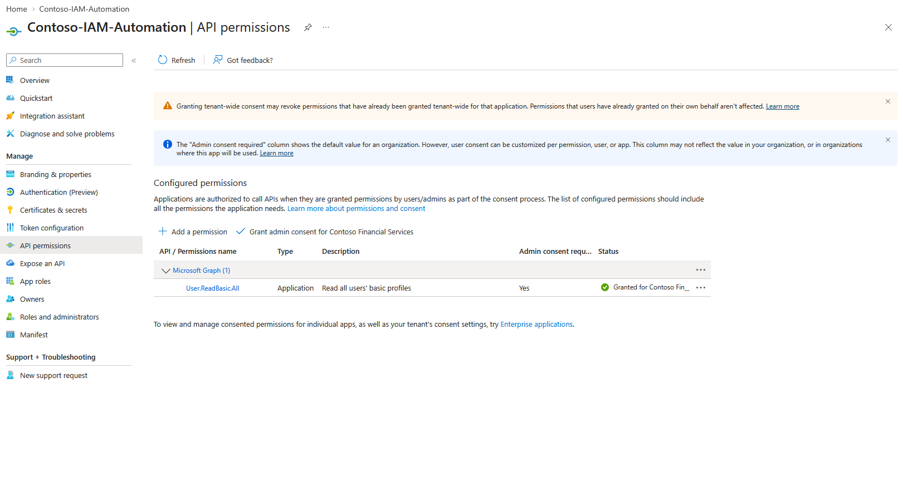

## Key Findings

- **Application registrations** define applications, while **service principals** represent their tenant-local security identities.
- App-only authentication and Graph authorization are distinct: the workload could read basic user profiles but received **403 Forbidden** when requesting Conditional Access policy data.
- The absence of an app owner is a governance gap; explicit ownership improves accountability but does not implement automated credential renewal.
- Comparing a certificate thumbprint across the Windows store, app registration, and sign-in log helps corroborate authentication evidence.
- Removing a permission from the app registration's configured list does not, by itself, prove that previously granted consent was revoked from every relevant grant.

## Outcome

The lab demonstrated a functioning certificate-authenticated workload with a narrowly scoped Microsoft Graph read permission, a successful read-only API test, a forbidden API test, an assigned technical owner, local credential-expiration checks, and a successful service principal sign-in audit record.

**Scope boundaries:** A repeat API authentication and authorization test was **not performed after the final configured-permission cleanup**. The local script is not a tenant-wide credential inventory, scheduled monitoring solution, or automatic renewal system. The lab did not configure managed identity, federation, or production credential rotation.
