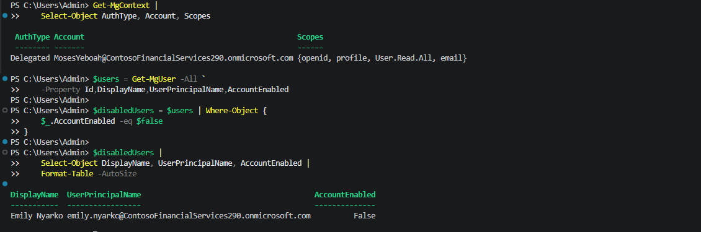
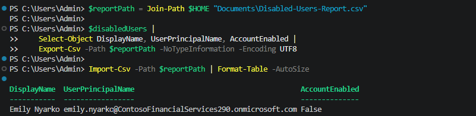

# Lab 12 - IAM Automation

## Overview

This lab demonstrates a small, read-only Microsoft Entra ID reporting workflow with Microsoft Graph PowerShell. Using an authorized delegated sign-in, the workflow retrieved directory users, identified accounts where **AccountEnabled = False**, exported those records to a CSV file, and re-imported the file to verify the report contents.

## Objectives

- Connect to Microsoft Graph using delegated authentication.
- Retrieve user accounts and the `accountEnabled` property.
- Identify disabled users without changing their accounts.
- Export a repeatable CSV identity inventory report.
- Read the exported file back to confirm its contents.

## Scenario

Contoso Financial Services needs a simple way to identify disabled accounts for IAM lifecycle follow-up. Checking users individually in the admin portal is inefficient. A read-only script can produce a report for review without granting account-modification permissions.

The fictional employee **Emily Nyarko**, previously disabled during the Joiner-Mover-Leaver exercise, provides a useful cross-lab validation case.

## Technologies Used

- Microsoft Entra ID
- Microsoft Graph PowerShell: `Microsoft.Graph.Authentication` and `Microsoft.Graph.Users`
- Delegated `User.Read.All` permission
- PowerShell objects, filtering, and CSV export/import

## Implementation Steps

### 1. Connected with delegated Microsoft Graph authentication

Installed the Graph Users module and connected with an authorized lab account, requesting the delegated **User.Read.All** scope. After an interrupted browser authentication attempt, device-code authentication succeeded. `Get-MgContext` confirmed `AuthType = Delegated` and the requested permission.

### 2. Retrieved and filtered disabled accounts

Queried user objects with `Get-MgUser -All`, explicitly requesting `Id`, `DisplayName`, `UserPrincipalName`, and `AccountEnabled`. Filtered to objects with `AccountEnabled = False`. The resulting output identified **Emily Nyarko** as disabled.

### 3. Exported and verified a CSV report

Selected the display name, user principal name, and account enabled state and exported them with `Export-Csv`. Re-imported the report using `Import-Csv` to confirm **Emily Nyarko** appeared with `AccountEnabled = False`.

### 4. Prepared a reusable reporting example

A reusable version of the demonstrated commands is included in [Export-DisabledUsersReport.ps1](scripts/Export-DisabledUsersReport.ps1). The evidence above proves the **interactive command sequence and resulting CSV**, not a separately tested invocation of the packaged script file.

## Key Findings

- Delegated Microsoft Graph access operates under both the application's consented scopes and the signed-in user's authorization.
- Requesting `AccountEnabled` explicitly avoids relying on default user properties.
- Filtering a read-only directory query provides an audit-friendly view of disabled accounts without modifying them.
- A successful `Import-Csv` check provides basic evidence that the CSV was written with the expected row and fields.
- The output is a point-in-time inventory, not a complete leaver remediation check. Disabled users may still require review of groups, application access, and related entitlements.

## Outcome

Successfully authenticated to Microsoft Graph, identified a disabled account, and exported and verified a CSV report. The finding aligns with the earlier leaver scenario involving Emily Nyarko.

**Scope boundaries:** This lab did not schedule unattended execution, send alerts, verify entitlement removal, or change any user account. The packaged reusable example was prepared from the demonstrated commands and has not been independently executed as a file in the captured evidence.
